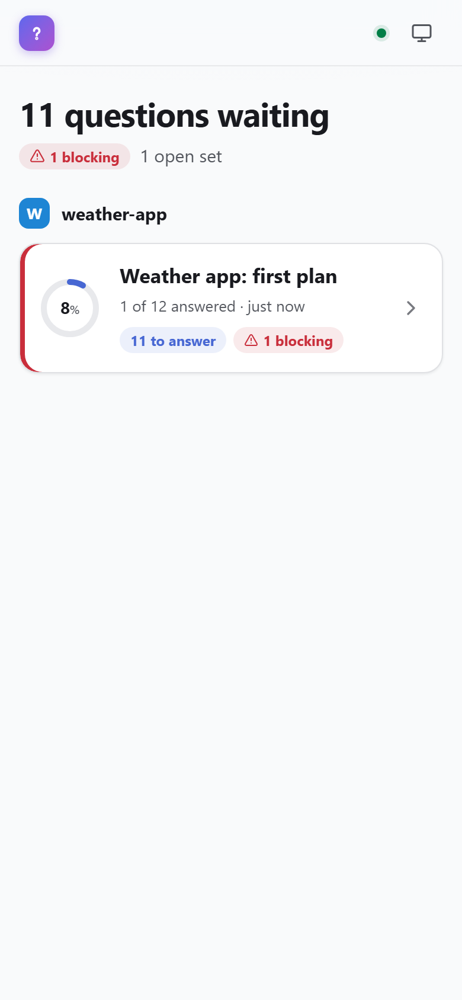
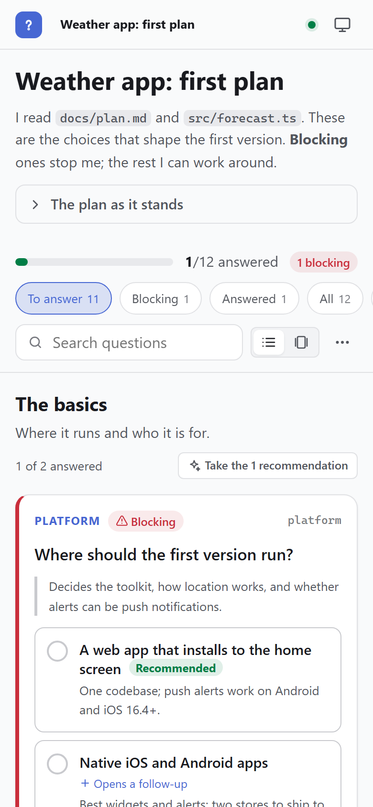
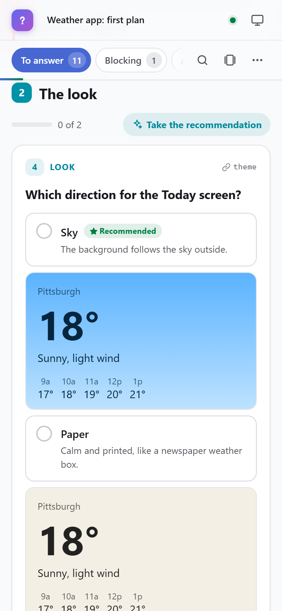
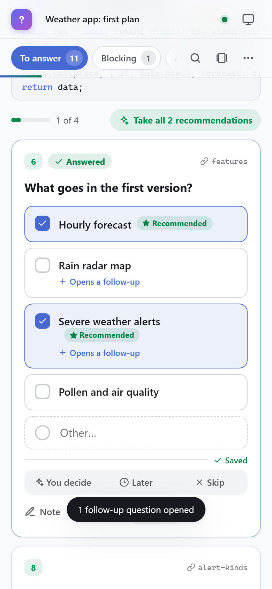
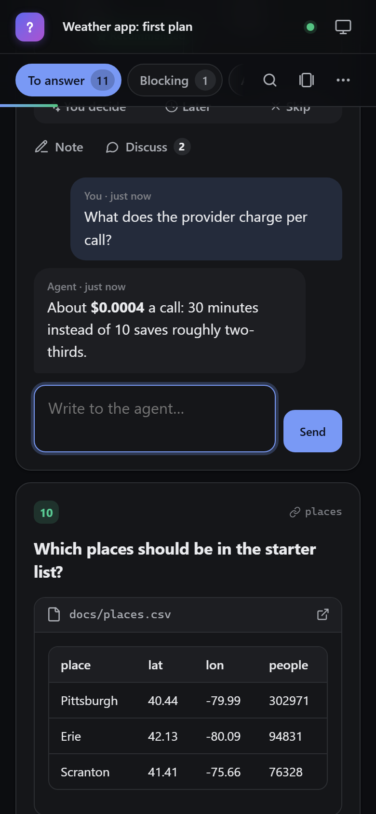
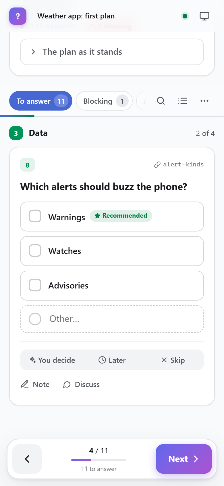
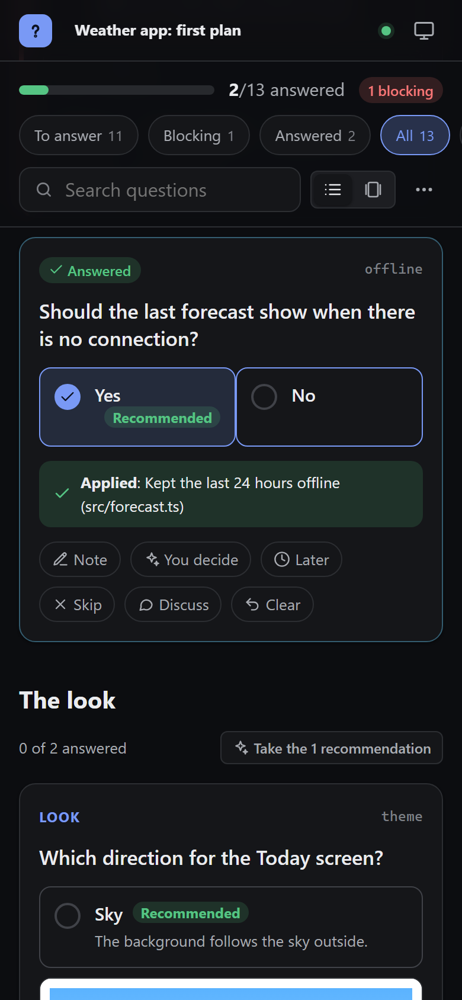
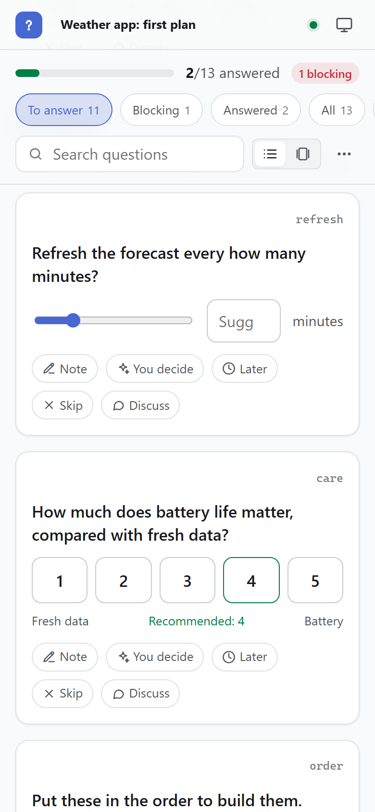

# questionme

Questions from an AI agent, answered on your phone.

When an agent has more than a few questions for you, a chat makes you answer them one at a time, in a hurry, without
pictures. questionme lets the agent write them all down: dozens or hundreds, grouped, with a recommendation for each, why
it matters, and what you need to see to decide (files, proposed code, diffs, diagrams, mockups). You answer on your phone,
at your own pace, on the same network. Your answers are saved in the project, and the agent reads only what's new.

```sh
npx questionme init     # once per project: the folder, the MCP server for Claude Code, a note in CLAUDE.md
npx questionme          # the page, for every project, with links for your phone
```

| | | |
|:-:|:-:|:-:|
|  |  |  |
| **Sets**, with what's left | **A set**, with progress and filters | **Options** with mockups |
|  |  |  |
| **Follow-ups** open as you pick | **Diffs** and **threads**, dark mode | **Cards**: one at a time |
|  |  | |
| **Applied**: the agent's note | **Numbers**, scales, rankings | |

## How it goes

1. **The agent asks.** It adds questions to a set (with the MCP tools, or by writing `.questionme/sets/<set>.json`) and
   gives you the link.
2. **You answer, on your phone.** Tap an option, or write your own. Add a note. Say **You decide** (take the
   recommendation), **Later**, or **Skip**. Ask **why** on any question; the agent can answer there. Picking an option can
   open follow-up questions. Answers save as you go.
3. **The agent reads what's new.** `get_answers` returns only answers since it last read, one line each, so 300 answers
   don't flood its context. It applies them and marks each **applied** with a note you see under the answer.
4. **It doesn't have to sit and wait.** The agent runs `npx questionme wait <set> --blocking` in the background and keeps
   working; the command exits, waking it, once you've answered what it needs.

## For Claude Code (and other agents)

`npx questionme init` in a project:

- makes `.questionme/` (sets and answers live here; commit them if you like),
- adds the MCP server to Claude Code for all your projects (`claude mcp add --scope user questionme -- npx -y questionme@latest mcp`),
- adds a short section to the project's `CLAUDE.md` (or `AGENTS.md`) on when and how to use it,
- with `--hook`, adds a hook that tells Claude about new answers whenever you send it a message.

The MCP server tells Claude when to use it (more than about 4 questions, questions that need thought or pictures, or
ones that can be answered while it works) and how.

### MCP tools

| Tool | |
|---|---|
| `add_questions` | Add questions to a set (made if new), in a section (made if new). Validated; returns the ids and the links. |
| `get_link` | Links to a set for your phone. Starts the shared server if it isn't running. |
| `get_answers` | Answers, one line each: `id (question): answer — note: "…"`. Filters: `new` (default; marks them read), `all`, `unacked`, `changed`, `blocking`, `open`. Pages with `limit`/`offset`. `format: "json"` for full records. |
| `wait_for_answers` | Block until there are new answers, the blocking questions are done, all are done, some ids are done, or a count is reached (up to 15 minutes). |
| `ack_answers` | Mark answers applied, with a note you see. |
| `reply` | Write on a question's thread. |
| `list_sets`, `show_set` | What's there and what state each question is in. Cheap. |
| `update_question`, `remove_questions`, `update_set`, `update_section` | Change things. Rewording a question flags an earlier answer as **changed** for you to look at again. |

### The CLI does the same

```sh
npx questionme list                              # sets, with counts
npx questionme show <set> [--full]               # the questions, one line each
npx questionme answers <set> --new               # what's new since the agent last read (marks it read; --peek doesn't)
npx questionme answers <set> --open              # what's still to answer, with the recommendations
npx questionme wait <set> --blocking             # exit once the blocking questions are answered, printing the new answers
npx questionme wait <set> --any --settle 60s     # exit once there are new answers and a minute has passed without more
npx questionme ack <set> <id…> --note "Done in src/x.ts"
npx questionme reply <set> <id> "Because the API bills per call."
npx questionme validate                          # check every set against the format
npx questionme schema                            # the format, as JSON Schema
npx questionme hook                              # one line per set with news (for a Claude Code hook; silent otherwise)
npx questionme notify ntfy                       # push notifications to your phone (see below)
```

`wait` is the seamless part: an agent starts it as a background command, carries on, and is woken when it exits.

## The format

A set is a JSON file, `.questionme/sets/<set>.json`. The schema is in [schema/set.schema.json](schema/set.schema.json)
(`"$schema": "https://unpkg.com/questionme/schema/set.schema.json"` gets you completion in an editor).

```json
{
  "title": "Weather app: first plan",
  "intro": "I read `docs/plan.md`. **Blocking** ones stop me.",
  "sections": [
    {
      "id": "basics",
      "title": "The basics",
      "questions": [
        {
          "id": "platform",
          "question": "Where should the first version run?",
          "why": "Decides the toolkit and how alerts work.",
          "blocking": true,
          "options": [
            { "id": "web", "label": "A web app", "description": "One codebase.", "recommended": true },
            { "id": "native", "label": "Native apps", "description": "Two stores.", "shows": ["stores"] }
          ]
        },
        {
          "id": "stores",
          "question": "Which store first?",
          "hidden": true,
          "options": ["App Store", "Google Play"]
        }
      ]
    }
  ]
}
```

### Questions

| Field | |
|---|---|
| `id` | Stable, unique in the set (questions and sections share ids). Answers are kept by id. |
| `question` | Markdown, short. |
| `type` | `single` (the default with options), `multi`, `yesno`, `text` (the default without), `number`, `scale` (1–5 unless `min`/`max`), `rank` (order the options). |
| `options` | Strings, or `{ id, label, description, recommended, content, shows, hides }`. |
| `recommended` | Option id(s), or a value for `number`, `scale` and `text`. Or `recommended: true` on options. |
| `why` | Markdown: what the answer changes. |
| `header` | A short label above the question. |
| `content` | Rich content (below). |
| `blocking` / `priority` | `blocking`, `high`, `normal`, `low`. Blocking questions are marked, counted and filterable, and `wait --blocking` waits for them. |
| `hidden`, `showIf` | Visibility (below). |
| `allowOther`, `allowNote` | An "Other…" answer and a note (both on by default). |
| `min`, `max`, `step`, `unit`, `minLabel`, `maxLabel`, `placeholder`, `multiline` | For numbers, scales and text. |

### Showing and hiding

Every question and section is shown unless it says `"hidden": true`. Then:

- **An option's `shows`** lists questions or sections to show while it's picked. **`hides`** lists ones to hide (hiding
  wins).
- **`showIf`** shows a question or section only while a condition holds:
  `{ "question": "platform", "any": ["native", "both"] }`. Also `all`, `none`, `answered: true|false`, and `gte`/`lte`
  for numbers. An array means all of them.
- **You decide** counts as picking the recommendation.
- A question in a hidden section is hidden, and picks in hidden questions don't count, so whole branches fold away.
  Their answers are kept (and reported as "now hidden") in case the branch comes back.

The page lists hidden questions under **Hidden**, with what would show each one.

### Rich content

`content` (on the set, a section, a question or an option) is a markdown string, or a list of blocks:

| Block | Shows |
|---|---|
| `"markdown"` or `{ "md": "…" }` | Markdown, GitHub-style, with Mermaid, math, tables and code. Relative links open project files. |
| `{ "file": "src/x.ts", "lines": "10-40" }` | A project file, drawn by kind (from folderview): code highlighted by Shiki, markdown rendered, images, SVG, audio, video, CSV as a table, Mermaid files, HTML as a sandboxed preview, PDF as a link. |
| `{ "code": "…", "lang": "ts", "title": "proposed" }` | Code, highlighted. |
| `{ "diff": "--- a/x\n+++ b/x\n@@ …" }` | A unified diff of proposed work, coloured, with its counts. |
| `{ "mermaid": "flowchart LR …" }` | A diagram. |
| `{ "image": "art/logo.png", "alt": "…" }` | A picture from the project, or an `https:` URL. |
| `{ "html": "<div>…</div>", "height": 240 }` | A mockup, in a sandboxed frame (no scripts). |
| `{ "link": "https://…", "label": "…" }` | A link. |

Any block can have a `title`, and `"collapsed": true` to start closed.

## Answers

Answers are saved in `.questionme/answers/<set>.json`, with a readable copy in `<set>.md` next to it. Each answer keeps
the picked option ids and their labels, any "Other", text or number, your note, when, and a fingerprint of the question
it answered. If the agent rewords the question later, the answer is flagged **changed** on the page (keep it or change
it) and in `get_answers`.

## The page

- **List** (every question, grouped) or **Cards** (one at a time, swipe or use the arrow keys, and it moves on after a
  pick).
- **Filters:** to answer, blocking, changed, later, answered, all, hidden. A filter stays put while you answer, so the
  card you just answered doesn't jump away.
- **Search** across questions and options.
- **Take the recommendations** for a section, or the whole set, then change the few you disagree with.
- **Colour per section**, numbered questions, a progress ring and bar, and a small celebration when you finish.
- **Live:** the agent's new questions, replies and "applied" notes appear as they happen, and so do answers from your
  other devices.
- Light and dark, a link to any question, and a prompt you can copy for the agent.

## One server for every project, or one folder

`npx questionme` starts **one shared server** (the hub) for every project you've used it in. Your phone needs one
bookmark. The MCP server starts the hub in the background when an agent needs a link, and adds the project to its list.

```sh
npx questionme                 # the hub (adds this folder); prints the links
npx questionme url [set]       # the links (starts the hub if needed)
npx questionme stop            # stop the hub
npx questionme projects        # what it serves;  --forget <folder> to drop one
npx questionme --solo [folder] # just this folder, on its own server
```

| Option | Environment | Default | |
|---|---|---|---|
| `-p, --port <n>` | `QUESTIONME_PORT` | `4195` | The port to try first; the next free one is used. |
| `-H, --host <addr>` | `QUESTIONME_HOST` | `0.0.0.0` | Where to listen. The default lets your phone reach it. |
| `--local` | | | Only this computer (`127.0.0.1`), no token. |
| `--token <t>` | `QUESTIONME_TOKEN` | made once | The token. Open a link with `?token=…` once on each device and it's kept as a cookie. |
| `--no-token` | | | No token: anyone on your network can open it. |
| `--allow-host <h>` | | | Accept this host name too (a tunnel's, say). |
| `-o, --open` | | | Open it in your browser. |
| `--read-only` | | | Look, don't answer. |

Your settings can also go in `~/.config/questionme/config.json` (`port`, `host`, `token` (or `false`), `allowHosts`,
`notify`).
`QUESTIONME_HOME` moves that folder. It also holds `projects.json` (the hub's list), `hub.json` (where it's running),
`token`, and `hub.log`.

The links include every address your phone might use: your Wi-Fi or LAN address, and a Tailscale address if you have
one. Virtual adapters (WSL, Docker, VMs) are left out.

## Notifications on your phone

The hub can buzz your phone when an agent adds questions or replies on a thread. Tapping the notification opens the set.

```sh
npx questionme notify ntfy             # makes a private ntfy topic, saves it, and sends a test
npx questionme notify webhook <url>    # or POST JSON anywhere: Pushover, Discord, Home Assistant, …
npx questionme notify link http://100.100.4.74:4195   # where the tap should open (default: Tailscale, else your LAN)
npx questionme notify test | off       # send a test, or stop
```

For ntfy, install the [ntfy app](https://ntfy.sh) (Android or iOS) and subscribe to the topic it prints. Changes are
batched: an agent adding 50 questions over a minute sends one notification ("Weather app: 50 new questions, 3
blocking"), once it has been quiet for 20 seconds (`quietSeconds` in the config) or two minutes have passed.
Notifications name the set and quote the first new question, never your answers. Links leave out the token unless you
set `includeToken`: open questionme once on your phone and its cookie does the rest.

The webhook gets `{ title, message, url, project, set, newQuestions, blocking, replies }`.

Why not Web Push: a phone only allows it on HTTPS pages, and questionme is opened over plain http on your network.

## Safety

- **A token by default.** The server listens on your network so your phone can reach it, so every request needs the
  token: in the link once, then a cookie. `--local` listens on this computer only.
- **Project files** shown in questions come only from inside that project, never `.git` or secret-looking files (`.env`,
  `*.key`, `*.pem`, `id_rsa`), and never through a link that points outside.
- **What an agent writes is treated as untrusted:** markdown is sanitised, HTML mockups run in a sandbox with no
  scripts, SVGs and files are served so they can't run script, and diagrams are drawn as images.
- **DNS rebinding** is refused (unknown host names), and so are writes from other sites.
- **It only writes** in `.questionme/answers/` (the page and the CLI), `.questionme/sets/` (the MCP tools and the CLI),
  and its own config folder. `init` also writes `CLAUDE.md` and, with `--hook`, `.claude/settings.json`.

## The API

| Request | |
|---|---|
| `GET api/ping` | `{ app: "questionme", version }` (no token needed) |
| `GET api/info` | The projects and a summary of each set |
| `GET api/p/<project>/s/<set>` | The set (normalised), its problems, the answers and a summary |
| `POST api/p/<project>/s/<set>/answer` | `{ id, status?, picked?, other?, text?, number?, order?, note? }` or `{ id, clear: true }` |
| `POST api/p/<project>/s/<set>/accept` | `{ ids }`: take the recommendations |
| `POST api/p/<project>/s/<set>/message` | `{ id, body }`: write on a thread |
| `GET api/p/<project>/text?path=&lines=` | A project file's text, for `file` blocks |
| `GET raw/<project>/<path>` | A project file |
| `GET api/events` | Server-sent events: `change` (a set or its answers), `projects` |

## Development

```sh
npm install
npm test                 # builds, then runs the tests
npm run dev -- --solo .questionme-test/demo --local   # after: node scripts/demo.mjs .questionme-test/demo
npm run screenshots      # the README's screenshots, from the demo project
```

Releasing: bump the version in `package.json` (`npm version patch --no-git-tag-version`), commit, push to main. The
Release workflow sees a version that isn't on npm yet, runs the tests, publishes it with trusted publishing, then tags
the commit `v<version>` and makes a GitHub release.

## License

MIT
